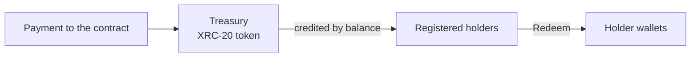

<p align="center">
  
</p>

<p align="center">
  
<a href="https://github.com/CoinClubQuincy/XRCDividendPlus/actions/workflows/build.yml"></a>        
</p>

<p align="center">
  <a href="#how-it-works">How it works</a> · <a href="#try-it">Try it</a> · <a href="#what-is-tested">What is tested</a> · <a href="#known-issues">Known issues</a>
</p>

Dividend+ lets a contract's earnings flow to the people holding its token. Each token is an equal claim, and each payment to the contract is credited to registered holders according to their balance.

> [!WARNING]
> This is a proof of concept and has not been audited. One [known issue](#known-issues) lets a single holder block all incoming payments.

## How it works




| Function | What it does |
| --- | --- |
| `constructor(name, symbol, totalSupply, decimals)` | Mints the supply to the deployer and registers them |
| `Register_Account()` | A token holder joins the dividend list. Unregistered holders receive nothing |
| `View_Account()` | Shows the caller's unclaimed dividends |
| `CountRegisterdShards()` | Totals the tokens held by registered accounts |
| `Redeem()` | Pays the caller's unclaimed dividends |

> [!IMPORTANT]
> Buying the token is not enough. Each new holder must call `Register_Account()` before a payment arrives, or that payment skips them.

## Try it

```bash
git clone https://github.com/CoinClubQuincy/XRCDividendPlus.git
cd XRCDividendPlus
git clone --depth 1 -b v4.9.6 https://github.com/OpenZeppelin/openzeppelin-contracts lib/openzeppelin-contracts
git clone --depth 1 -b v1.9.7 https://github.com/foundry-rs/forge-std lib/forge-std
forge test
```

You need [Foundry](https://getfoundry.sh). Tests named `test_KnownIssue_*` pass because they pin a defect, so a passing run does not mean the defect is gone.

To try it on a network, use the Apothem testnet:

| Network | Chain ID | RPC |
| --- | --- | --- |
| Apothem testnet | 51 | `https://rpc.apothem.network` |
| XDC mainnet | 50 | `https://rpc.xinfin.network` |

```bash
forge create contracts/Treasury.sol:Treasury --rpc-url https://rpc.apothem.network --interactive --broadcast --legacy \
  --constructor-args "Plus" "PLS" 1000 0
```

## What is tested

[`test/foundry/Treasury.t.sol`](test/foundry/Treasury.t.sol) has 6 tests and runs in CI on every push.

| Tested | Not tested |
| --- | --- |
| Dividends following registered balances | A real network, testnet or mainnet |
| Unregistered holders being left out | An independent security audit |
| | The older `test/Plus.js`, which was not run |

## Known issues

| Issue | Effect | Test |
| --- | --- | --- |
| A registered holder with a zero balance breaks accounting | Once a registered holder sends away all their tokens, every later payment to the contract fails | `test_KnownIssue_RegisteredHolderWithZeroBalanceBlocksAllPayments` |
| Small payments are lost to rounding | With 18-decimal supply, a payment smaller than the supply credits nobody and stays locked | `test_KnownIssue_PaymentSmallerThanSupplyAllocatesNothing` |
| `decimals` only scales the supply | `decimals()` still reports 18, so wallets show the wrong amount unless you pass 18 | `test_KnownIssue_DecimalsArgumentDoesNotChangeTokenDecimals` |

<details>
<summary><strong>More XDC projects</strong></summary>

| Group | Project | What it is |
| --- | --- | --- |
| Standards | [XRC-SHARES](https://github.com/CoinClubQuincy/XRC-SHARES) | Dividend-paying NFT shares and SPLITS for a DApp |
| Treasury and finance | [Multi-Sig-Treasury](https://github.com/CoinClubQuincy/Multi-Sig-Treasury) | Treasury controlled by tokenized keys |
| Treasury and finance | [XRC-Airdrop](https://github.com/CoinClubQuincy/XRC-Airdrop) | Self-run token airdrop |
| Treasury and finance | [XRC-Credit](https://github.com/CoinClubQuincy/XRC-Credit) | Debt contract skeleton |
| Treasury and finance | [XDC-Defi-Instruments](https://github.com/CoinClubQuincy/XDC-Defi-Instruments) | Assets, agreements, forwards, futures and a marketplace |
| Identity and access | [LoginMFAContract](https://github.com/CoinClubQuincy/LoginMFAContract) | Login with a password and an NFT |
| Identity and access | [PrivateAccessToken](https://github.com/CoinClubQuincy/PrivateAccessToken) | Token-gated contract data demo |
| Identity and access | [Delegated_Authority](https://github.com/CoinClubQuincy/Delegated_Authority) | KYC notary proof of concept |
| Learning and libraries | [XDC-LemonadeStand](https://github.com/CoinClubQuincy/XDC-LemonadeStand) | Workshop DApp built on XRC-SHARES |
| Learning and libraries | [Non-Financial-SmartContracts](https://github.com/CoinClubQuincy/Non-Financial-SmartContracts) | Games, inventory, keys and on-chain repositories |
| Tools | [XDC_Python_SDK_V1](https://github.com/CoinClubQuincy/XDC_Python_SDK_V1) | Python client for the XDC JSON-RPC API |
| Tools | [PrivateXDCNode_SetupScript](https://github.com/CoinClubQuincy/PrivateXDCNode_SetupScript) | Private XDC network setup scripts |
| Tools | [WebApp_to_XDCPay](https://github.com/CoinClubQuincy/WebApp_to_XDCPay) | Web app to XDCPay tutorial |
| Multi-chain | [CoinClub_Framework](https://github.com/CoinClubQuincy/CoinClub_Framework) | Python library with an XDC adapter |
| Interfaces | [Contract_Interface_Model_Language](https://github.com/CoinClubQuincy/Contract_Interface_Model_Language) | Interface documents for smart contracts and APIs |

</details>

## License

MIT, as declared in the SPDX headers of the source files. This repository has no separate license file.
