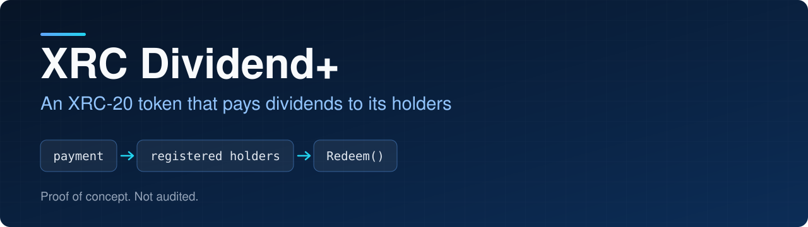
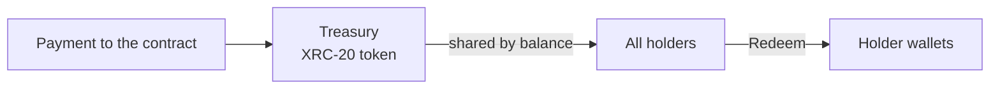

<p align="center">
  
</p>

<p align="center">
  
<a href="https://github.com/CoinClubQuincy/XRCDividendPlus/actions/workflows/build.yml"></a>        
</p>

<p align="center">
  <a href="#how-it-works">How it works</a> · <a href="#try-it">Try it</a> · <a href="#what-is-tested">What is tested</a> · <a href="#known-issues">Known issues</a>
</p>

Dividend+ lets a contract's earnings flow to the people holding its token. Each token is an equal claim, and each payment to the contract is shared across all holders according to their balance. Nobody has to register, and payments cost the same however many holders there are.

> [!WARNING]
> This is a proof of concept. It has not been audited and has not run on a real network. See [Known issues](#known-issues).

## How it works




| Function | What it does |
| --- | --- |
| `constructor(name, symbol, totalSupply, decimals)` | Mints the supply to the deployer. `decimals()` reports the value you pass |
| `View_Account()` | Shows the caller's unclaimed dividends |
| `Redeem()` | Pays the caller's unclaimed dividends |
| `CountRegisterdShards()` | Returns the total supply, since every token earns |
| `Register_Account()` | Does nothing and returns true. It is kept for older callers |

Each payment raises a running total of what one token has earned. Before any transfer changes a balance, the contract records what that holder has earned so far. Dividends stay with whoever held the tokens when the payment arrived, so someone who sells everything can still redeem.

## Try it

```bash
git clone https://github.com/CoinClubQuincy/XRCDividendPlus.git
cd XRCDividendPlus
git clone --depth 1 -b v4.9.6 https://github.com/OpenZeppelin/openzeppelin-contracts lib/openzeppelin-contracts
git clone --depth 1 -b v1.9.7 https://github.com/foundry-rs/forge-std lib/forge-std
forge test
```

You need [Foundry](https://getfoundry.sh).

To try it on a network, use the Apothem testnet:

| Network | Chain ID | RPC |
| --- | --- | --- |
| Apothem testnet | 51 | `https://rpc.apothem.network` |
| XDC mainnet | 50 | `https://rpc.xinfin.network` |

```bash
forge create contracts/Treasury.sol:Treasury --rpc-url https://rpc.apothem.network --interactive --broadcast --legacy \
  --constructor-args "Plus" "PLS" 1000 0
```

## What is tested

[`test/foundry/Treasury.t.sol`](test/foundry/Treasury.t.sol) has 15 tests, including one fuzz test, and runs in CI on every push.

| Tested | Not tested |
| --- | --- |
| Holders earning without registering | A real network, testnet or mainnet |
| Earnings staying with whoever held the tokens, including after selling everything | An independent security audit |
| Payments smaller than the supply accumulating instead of being lost | |
| Holders with a zero balance blocking nothing | |
| `decimals` setting the reported decimals | |
| Paying once, a reentrant holder, and a failed payout keeping the credit | |
| Fuzz: with transfers between payments, nobody withdraws more than was paid and the contract stays solvent | |

## Changes from earlier versions

Contracts already deployed are unaffected and keep the old behaviour.

- All holders now earn automatically. `Register_Account` does nothing and returns true, and it no longer reverts on a second call.
- `CountRegisterdShards` returns the total supply.
- `View_Account` works for any address. It used to revert for non-holders and unregistered holders.
- `decimals()` now reports the constructor value instead of always 18.
- The public `accounts`, `ledger` and `Account_Counter` values were removed. They only made sense with registration.
- `totalAllocated` now means the total of all payments received.
- `magnifiedPerShare` is new and public.
- Payments under the total supply are no longer lost, and a holder with a zero balance no longer blocks payments.
- The constructor refuses a zero supply.
- The older `test/Plus.js` and tracked build output were removed. Foundry is the supported test path.

## Known issues

| Issue | Effect | Test |
| --- | --- | --- |
| Paying with Solidity's `transfer` or `send` fails | These forward 2,300 gas, and recording a payment writes to storage, which costs more than that. Pay with `call` instead. This is an EVM limit | `test_KnownLimit_LowGasSendersCannotPay` |
| Rounding can hold back a little | A holder can be up to 1 wei short. The amount stays in the contract | The fuzz test |
| Dividends on tokens sent to this contract are stuck | The contract counts as a holder and cannot redeem for itself | Read from the code |
| Burn addresses keep earning | Tokens at an address nobody controls still earn dividends that nobody can claim | Read from the code |

<details>
<summary><strong>More XDC projects</strong></summary>

| Group | Project | What it is |
| --- | --- | --- |
| Standards | [XRC-SHARES](https://github.com/CoinClubQuincy/XRC-SHARES) | Dividend-paying NFT shares and SPLITS for a DApp |
| Treasury and finance | [Multi-Sig-Treasury](https://github.com/CoinClubQuincy/Multi-Sig-Treasury) | Treasury controlled by tokenized keys |
| Treasury and finance | [XRC-Airdrop](https://github.com/CoinClubQuincy/XRC-Airdrop) | Self-run token airdrop |
| Treasury and finance | [XRC-Credit](https://github.com/CoinClubQuincy/XRC-Credit) | Debt contract skeleton |
| Treasury and finance | [XDC-Defi-Instruments](https://github.com/CoinClubQuincy/XDC-Defi-Instruments) | Assets, agreements, forwards, futures and a marketplace |
| Identity and access | [LoginMFAContract](https://github.com/CoinClubQuincy/LoginMFAContract) | Login with a password and an NFT |
| Identity and access | [PrivateAccessToken](https://github.com/CoinClubQuincy/PrivateAccessToken) | Token-gated contract data demo |
| Identity and access | [Delegated_Authority](https://github.com/CoinClubQuincy/Delegated_Authority) | KYC notary proof of concept |
| Learning and libraries | [XDC-LemonadeStand](https://github.com/CoinClubQuincy/XDC-LemonadeStand) | Workshop DApp built on XRC-SHARES |
| Learning and libraries | [Non-Financial-SmartContracts](https://github.com/CoinClubQuincy/Non-Financial-SmartContracts) | Games, inventory, keys and on-chain repositories |
| Tools | [XDC_Python_SDK_V1](https://github.com/CoinClubQuincy/XDC_Python_SDK_V1) | Python client for the XDC JSON-RPC API |
| Tools | [PrivateXDCNode_SetupScript](https://github.com/CoinClubQuincy/PrivateXDCNode_SetupScript) | Private XDC network setup scripts |
| Tools | [WebApp_to_XDCPay](https://github.com/CoinClubQuincy/WebApp_to_XDCPay) | Web app to XDCPay tutorial |
| Multi-chain | [CoinClub_Framework](https://github.com/CoinClubQuincy/CoinClub_Framework) | Python library with an XDC adapter |
| Interfaces | [Contract_Interface_Model_Language](https://github.com/CoinClubQuincy/Contract_Interface_Model_Language) | Interface documents for smart contracts and APIs |

</details>

## License

MIT, as declared in the SPDX headers of the source files. This repository has no separate license file.
